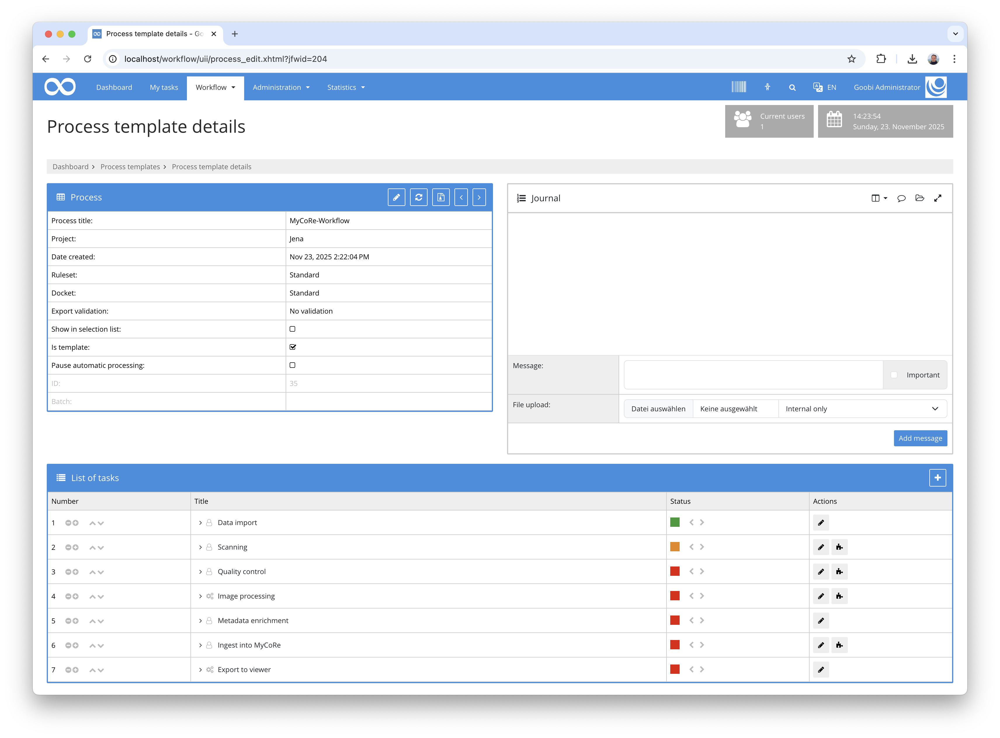
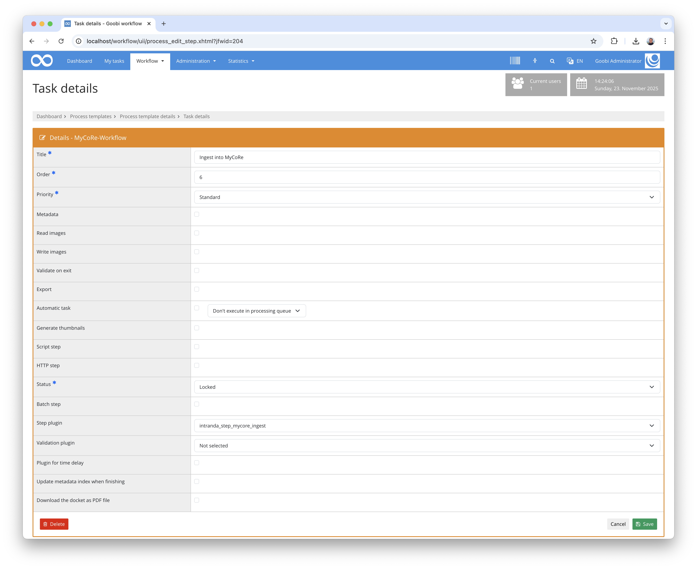

## Introduction
This documentation explains the plugin for automated ingest into a MyCoRe repository.

## Installation
To use the plugin, the following files must be installed:

```bash
/opt/digiverso/goobi/plugins/step/plugin-step-mycore-ingest-base.jar
/opt/digiverso/goobi/config/plugin_intranda_step_mycore_ingest.xml
```

After installing the plugin, it can be selected within the workflow for the respective work steps and thus executed automatically. An example workflow could look like this:



To use the plugin, it must be selected in a work step:




## Overview and functionality
When this plugin is activated, it starts the ingest process in MyCoRe. To do this, the METS file is first transformed by exporting a METS file and then transforming it using an xsl file from a configurable URL. The XML file generated in this way is then used to create a volume in MyCoRe and a derivative is generated within it. The media files, full-text files and METS file are then uploaded together with the anchor file within the derivative. 

Finally, the checksums and sizes of the files are determined and compared, and stored as an ingest receipt within the process journal.


## Configuration
The plugin is configured in the file `plugin_intranda_step_mycore_ingest.xml` as shown here:

{{CONFIG_CONTENT}}

{{CONFIG_DESCRIPTION_PROJECT_STEP}}

Parameter               | Explanation
------------------------|------------------------------------
`xslt-url`              | Specify the URL where an xsl file for the transformation can be accessed. A sample file is located in the `docs` directory of the plugin.
`mycore-api`            | URL for the MyCoRe API
`mycore-login`          | Enter your login name
`mycore-password`       | Enter your login password
`max-tries`             | Information about the maximum number of attempts to be used for ingest
`debug-mets-before-xslt` | Optional. Full file path where the exported METS file is saved before the XSLT transformation.
`debug-mets-after-xslt` | Optional. Full file path where the result of the XSLT transformation is saved, exactly as it is sent to MyCoRe.

### Debug files
For troubleshooting, the plugin can save the exported METS file and the result of the XSLT transformation. This helps to find out whether a problem comes from the METS export or from the transformation. Each of the two parameters can be used on its own; if a parameter is missing or empty, the file is not saved.

- The value is a full absolute path including the file name, not a folder. Missing folders are created.
- Goobi variables can be used, so either a global folder or a folder per process works, e.g. `{processpath}/debug/mets.xml` or `/opt/digiverso/debug/{processtitle}_mets.xml`. In a shared folder, include `{processtitle}` or `{processid}` so that processes do not overwrite each other's files.
- Without a date variable, every run overwrites the previous file. With `{datetime.yyyyMMdd-HHmmss}` every run creates a new file; both files of one run get the same time stamp. The date pattern must not contain `)` or `}`.
- When configured, the files are saved on every run. The METS file is saved right after the export, the transformation result before it is sent to MyCoRe, so both are available even if a later step fails.
- Old debug files are never deleted automatically.
- If a debug file cannot be saved, only a warning is logged; the ingest continues.
